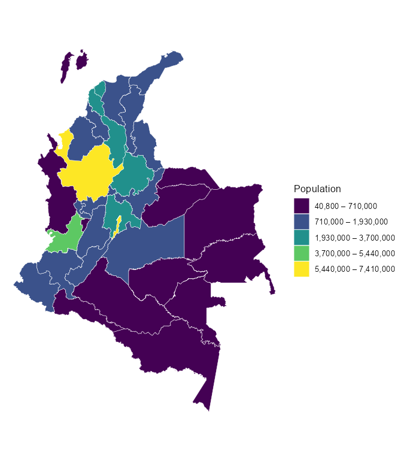

# atlasr

Quick maps of Colombia by department, from a data frame with DIVIPOLA codes,
without handling geometries.

```r
# install.packages("remotes")
remotes::install_github("edalfon/atlasr")
```

## Usage

```r
library(atlasr)

df <- data.frame(
  dept_cod = c("05", "08", "11", "76", "88"),
  rate     = c(0.42, 0.74, 0.50, 0.55, 0.38)
)

# interactive (mapview / leaflet); several zcol give several layers
map_dept(df, zcol = c(`C-section rate` = "rate"))

# static (ggplot2), San Andrés and Providencia moved next to the mainland
map_dept_static(df, zcol = c(`C-section rate` = "rate"),
                discretize = "quantile", n_breaks = 4)
```



- Codes can be character or numeric: `5`, `"5"` and `"05"` all match
  Antioquia. A national-total row (`"00"`) is ignored.
- `discretize`: `"none"`, `"jenks"`, `"quantile"` or `"equal"`.
- `tooltip` (interactive): `"auto"` or a glue template on the joined data,
  e.g. `"{dept_nom}: {scales::percent(rate)}"`.
- `map_dept_static()` returns a `ggplot`, so you can keep adding to it.

## Geometries

atlasr ships no geometry data. `atlas_geom()` downloads the department
polygons on first use, caches them (`atlas_cache_dir()`), and works offline
after that:

1. [ColOpenData](https://cran.r-project.org/package=ColOpenData): DANE's
   Marco Geoestadístico Nacional 2018, simplified.
2. Fallback, when ColOpenData's server is unavailable:
   [geoBoundaries](https://www.geoboundaries.org/) gbOpen COL ADM1 (IGAC 2024,
   CC BY 4.0). It has names only; atlasr adds the DIVIPOLA codes from a small
   internal lookup table (`data-raw/gb_codes.R`).

`atlas_geom(inset = TRUE)` moves and enlarges San Andrés and Providencia next
to the Caribbean coast (static maps only; the islands' coordinates are no
longer real). `atlas_cache_clear()` forces a fresh download.

## History

atlasr started in 2018 as an internal package for the atlas project, built on
`sp`/`rgeos` with bundled IGAC polygons. Version 0.1 is a rewrite on `sf`;
the old code is in the first commit.
