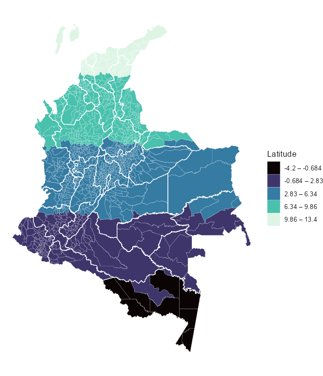

# atlasr

Quick maps of Colombia by department or municipality, from a data frame with
DIVIPOLA codes, without handling geometries.

```r
# install.packages("remotes")
remotes::install_github("edalfon/atlasr")
```

## Usage

```r
library(atlasr)

df <- data.frame(
  dept_cod = c("05", "08", "11", "76", "88"),
  rate     = c(0.42, 0.74, 0.50, 0.55, 0.38)
)

# interactive (mapview / leaflet over an Esri basemap, no API key needed);
# several zcol give several layers
map_dept(df, zcol = c(`C-section rate` = "rate"))

# static (ggplot2)
map_dept_static(df, zcol = c(`C-section rate` = "rate"),
                discretize = "quantile", n_breaks = 4)

# municipalities: same arguments, joined on muni_cod
map_muni(muni_df, zcol = "rate")
map_muni_static(muni_df, zcol = "rate", palette = "mako")
```


| function | level | output |
|---|---|---|
| `map_dept()` | departments (`dept_cod`, 2 digits) | interactive (`mapview`) |
| `map_dept_static()` | departments | static (`ggplot`) |
| `map_muni()` | municipalities (`muni_cod`, 5 digits) | interactive (`mapview`) |
| `map_muni_static()` | municipalities | static (`ggplot`) |

- All four take the same arguments and bin the same way, so the same call
  gives the same classes and colours on either map.
- Codes can be character or numeric: `5`, `"5"` and `"05"` all match
  Antioquia; `5001` and `"05001"` match Medellín. A national-total row
  (`"00"`) is ignored.
- San Andrés and Providencia are moved and enlarged next to the mainland
  (`inset = TRUE`, the default), so their colour is visible at country scale.
  On the interactive maps they then sit over the sea of the basemap;
  `inset = FALSE` gives the real geometry.
- `discretize`: `"pretty"` (round numbers, the default), `"jenks"`,
  `"quantile"`, `"equal"` or `"none"` (continuous). `n_breaks` sets the
  number of classes.
- `palette`: a viridis option (`"viridis"`, `"magma"`, `"mako"`, ...), colours
  to interpolate (`c("white", "darkred")`) or a function `n -> colours`.
- Municipal maps draw department borders on top (`dept_borders = TRUE`), and
  their tooltips name the department too ("Medellín (Antioquia)").
- `basemaps` (interactive): Esri's grey canvas and topographic map by default,
  which need no API key.
- `tooltip` (interactive): `"auto"` or a glue template on the joined data,
  e.g. `"{dept_nom}: {scales::percent(rate)}"`.
- The static maps return a `ggplot`, so you can keep adding to it.



## Geometries

atlasr ships no geometry data. `atlas_geom("dept")` and `atlas_geom("muni")`
download the polygons on first use, cache them (`atlas_cache_dir()`), and
work offline after that:

1. [ColOpenData](https://cran.r-project.org/package=ColOpenData): DANE's
   Marco Geoestadístico Nacional 2018, simplified.
2. Fallback, when ColOpenData's server is unavailable:
   [geoBoundaries](https://www.geoboundaries.org/) gbOpen COL (CC BY 4.0):
   departments from IGAC (2024), municipalities from DANE (2020). It has names
   only, so atlasr adds the DIVIPOLA codes: departments by name, and
   municipalities by which polygon contains each municipal seat, since
   municipal names repeat.

Names come from DIVIPOLA whatever the source. Municipalities created after the
source's boundaries have no polygon (Belén de Bajirá, 27086, in
geoBoundaries). The internal lookup tables (codes, names and seat locations,
no geometry) are built by `data-raw/sysdata.R`.

`atlas_geom(inset = TRUE)` returns the geometries with San Andrés and
Providencia moved and enlarged next to the Caribbean coast.
`atlas_cache_clear()` forces a fresh download.

## History

atlasr started in 2018 as an internal package for the atlas project, built on
`sp`/`rgeos` with bundled IGAC polygons. Version 0.1 is a rewrite on `sf`;
the old code is in the first commit.
