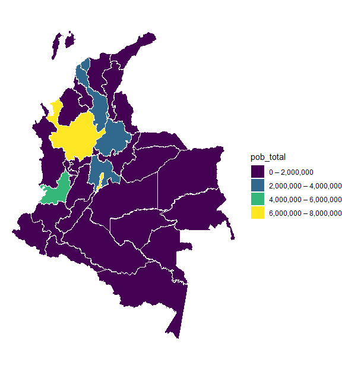
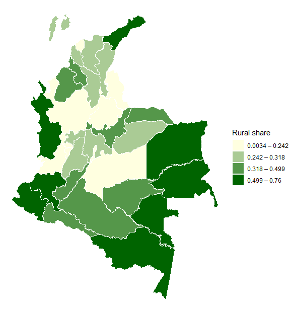
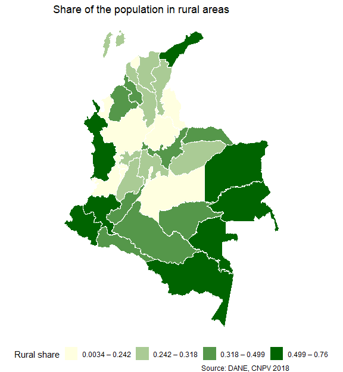
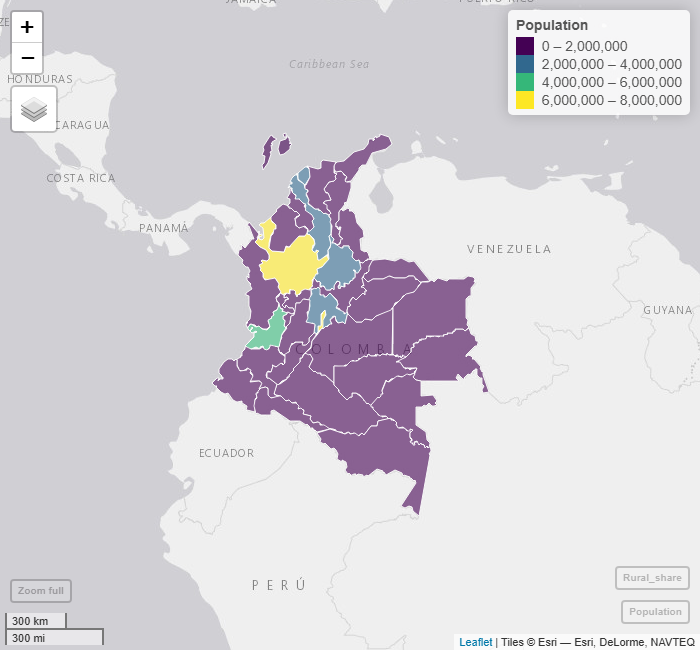
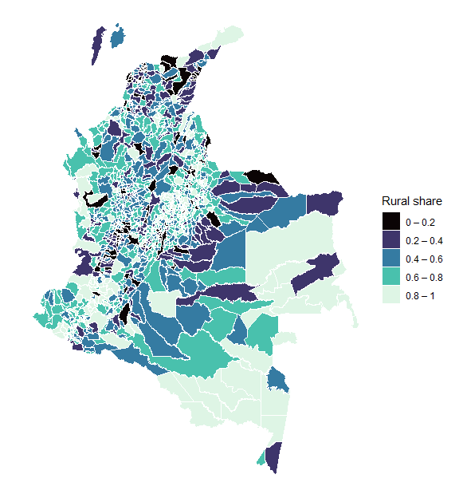
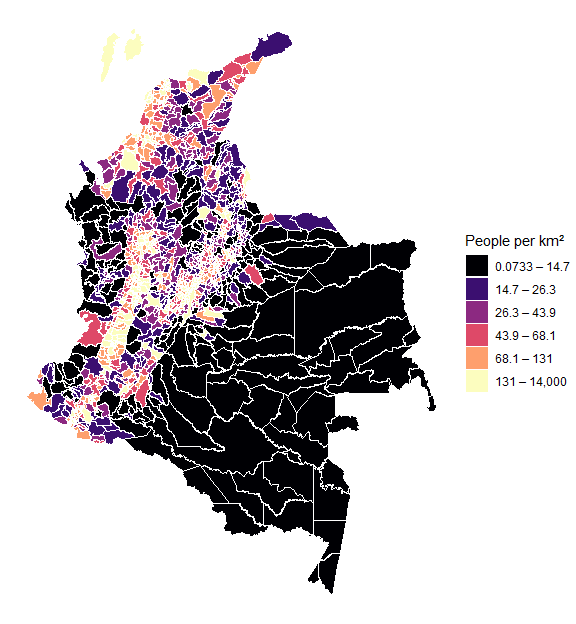
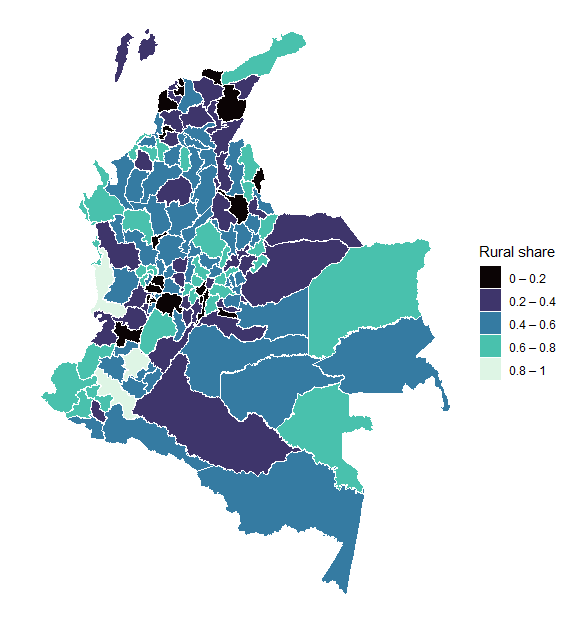

<!-- atlasr.Rmd is generated from atlasr.Rmd.orig by vignettes/precompile.R:
     the maps need geometries downloaded from the internet, so the vignette is
     knitted once, locally, and the package ships the result. Edit the .orig
     file, not atlasr.Rmd. -->


atlasr draws maps of Colombia from a data frame with DIVIPOLA codes. You
never touch a geometry: atlasr downloads the polygons the first time you need
them, caches them, and joins your data to them by code.

There are three levels, each with an interactive map (mapview, on top of
leaflet) and a static one (ggplot2):

| level | code | interactive | static |
|---|---|---|---|
| departments | `dept_cod`, 2 digits | `map_dept()` | `map_dept_static()` |
| provinces | `prov_cod`, 4 characters | `map_prov()` | `map_prov_static()` |
| municipalities | `muni_cod`, 5 digits | `map_muni()` | `map_muni_static()` |

All six take the same arguments. This vignette uses the 2018 census
population by department and municipality (DANE's CNPV 2018), as tabulated in
the [daner](https://github.com/edalfon/daner) package.


``` r
library(atlasr)

pob_dept <- daner::pob_2018_dept
head(pob_dept[c("dept_cod", "dept_nom", "pob_total", "pob_rural")])
#>   dept_cod       dept_nom pob_total pob_rural
#> 1       00 Total Nacional  48258494  11833841
#> 2       05      Antioquia   6407102   1434161
#> 3       08      Atlántico   2535517    130686
#> 4       11   Bogotá, D.C.   7412566     25166
#> 5       13        Bolívar   2070110    521047
#> 6       15         Boyacá   1217376    509370
```

## Departments

Give the data and the variable to map. The data needs one row per
department, with the code in a column called `dept_cod` (or say which column
with `join_var`). The national total (`"00"`) in DANE tables is ignored.


``` r
map_dept_static(pob_dept, zcol = "pob_total")
```



The values are binned into classes with round limits (`discretize =
"pretty"`). The legend title is the variable name; name the variable in
`zcol` to give it a better one. Other binning methods are `"jenks"`
(natural breaks), `"quantile"` and `"equal"`, with `n_breaks` classes, or
`"none"` for a continuous scale. `palette` takes a viridis option
(`"viridis"`, `"magma"`, `"mako"`, ...), a few colours to interpolate, or a
function.


``` r
pob_dept$rural <- pob_dept$pob_rural / pob_dept$pob_total

map_dept_static(pob_dept, zcol = c(`Rural share` = "rural"),
                discretize = "quantile", n_breaks = 4,
                palette = c("lightyellow", "darkgreen"))
```



San Andrés and Providencia are moved and enlarged next to the Caribbean
coast, as in most printed maps of Colombia, so that their colour is visible
at this scale. `inset = FALSE` draws them where they really are, about
700 km from the coast and too small to see.

The static maps are `ggplot` objects, so you can keep adding to them:


``` r
map_dept_static(pob_dept, zcol = c(`Rural share` = "rural"),
                discretize = "quantile", n_breaks = 4,
                palette = c("lightyellow", "darkgreen")) +
  ggplot2::labs(title = "Share of the population in rural areas",
                caption = "Source: DANE, CNPV 2018") +
  ggplot2::theme(legend.position = "bottom")
```



### Interactive maps

`map_dept()` takes the same arguments and draws the same classes and colours
on an interactive map. Several variables give several layers, one shown at a
time, which you switch in the layer control:


``` r
map_dept(pob_dept, zcol = c(Population = "pob_total",
                            `Rural share` = "rural"))
```



Hovering over a department shows its name and value. For another text, give
`tooltip` a [glue](https://glue.tidyverse.org/) template, evaluated on the
joined data:


``` r
map_dept(pob_dept, zcol = c(`Rural share` = "rural"),
         tooltip = "{dept_nom}: {scales::percent(rural, 0.1)} rural")
```

The basemaps, Esri's grey canvas and topographic map, need no API key.
Anything else in `...` goes to `mapview::mapview()`, e.g. `alpha.regions =
0.5` for more see-through polygons. The result is a `mapview` object, so you
can add more layers with `+`.

## Municipalities

The same, with 5-digit municipal codes in `muni_cod`. Codes can be numbers
or text: `5001`, `"5001"` and `"05001"` all match Medellín. Department
borders are drawn on top (`dept_borders = FALSE` to leave them out).


``` r
pob_muni <- daner::pob_2018_muni
pob_muni$rural <- pob_muni$pob_rural / pob_muni$pob_total

map_muni_static(pob_muni, zcol = c(`Rural share` = "rural"),
                palette = "mako")
```



`atlas_geom()` gives you the polygons themselves, as an `sf` object, when
you need them for something else, here the area of each municipality to get
population density. A few cities are far denser than everything else, so
quantiles (classes with the same number of municipalities) show the pattern
better than classes by value:


``` r
muni <- atlas_geom("muni")
muni$area_km2 <- as.numeric(sf::st_area(muni)) / 1e6
pob_muni$density <- pob_muni$pob_total /
  muni$area_km2[match(pob_muni$muni_cod, muni$muni_cod)]

map_muni_static(pob_muni, zcol = c(`People per km²` = "density"),
                discretize = "quantile", n_breaks = 6, palette = "magma")
```



Codes that match no polygon are dropped with a warning. Belén de Bajirá
(27086), for instance, is in DIVIPOLA but has no polygon in the 2020
boundaries atlasr uses when ColOpenData is not available:


``` r
p <- map_muni_static(data.frame(muni_cod = c("05001", "27086"), x = 1:2), "x")
#> Warning: Codes in `data` that match no municipality in the geoboundaries
#> geometries (dropped): 27086
```

## Provinces

DANE groups the municipalities of each department into provinces (Valle del
Aburrá, Urabá, ...). `atlas_provinces()` says which municipalities each one
has, so you can add up municipal data:


``` r
provinces <- atlas_provinces()
head(provinces)
#>   muni_cod   muni_nom prov_cod         prov_nom dept_cod  dept_nom
#> 1    05001   Medellín     0509 Valle del Aburra       05 Antioquia
#> 2    05002  Abejorral     0506          Oriente       05 Antioquia
#> 3    05004   Abriaquí     0505        Occidente       05 Antioquia
#> 4    05021 Alejandría     0506          Oriente       05 Antioquia
#> 5    05030      Amagá     0507         Suroeste       05 Antioquia
#> 6    05031     Amalfi     0503         Nordeste       05 Antioquia

pob_muni$prov_cod <- provinces$prov_cod[match(pob_muni$muni_cod,
                                              provinces$muni_cod)]
pob_prov <- aggregate(cbind(pob_total, pob_rural) ~ prov_cod, pob_muni, sum)
pob_prov$rural <- pob_prov$pob_rural / pob_prov$pob_total
```

DANE gives provinces no code, so atlasr makes one: the department code plus
the province's position in the department, in alphabetical order (`"0509"`
is Valle del Aburrá, the ninth province of Antioquia). Province names repeat
across departments ("Norte" is a province in 13 of them), so join on the code, or on
the name and the department together.


``` r
map_prov_static(pob_prov, zcol = c(`Rural share` = "rural"),
                palette = "mako")
```



## Geometries

atlasr ships no geometry data. The first call for a level downloads it and
keeps it in a cache folder (`atlas_cache_dir()`); later calls, also in later
sessions, read the cache and work offline. Provinces are the municipalities
merged, so they need no download of their own.

The polygons come from:

1. [ColOpenData](https://cran.r-project.org/package=ColOpenData): DANE's
   Marco Geoestadístico Nacional 2018, simplified.
2. When ColOpenData is not available:
   [geoBoundaries](https://www.geoboundaries.org/) (CC BY 4.0), with
   departments from IGAC (2024) and municipalities from DANE (2020).
   geoBoundaries has names but no codes, so atlasr gives each municipal
   polygon the code of the municipal seat that falls inside it.

Names always come from DIVIPOLA, whatever the source.


``` r
dept <- atlas_geom("dept")
dept
#> Simple feature collection with 33 features and 2 fields
#> Geometry type: MULTIPOLYGON
#> Dimension:     XY
#> Bounding box:  xmin: -81.73561 ymin: -4.225938 xmax: -66.85689 ymax: 13.39411
#> Geodetic CRS:  WGS 84
#> First 10 features:
#>    dept_cod  dept_nom                       geometry
#> 1        05 Antioquia MULTIPOLYGON (((-74.66496 5...
#> 2        08 Atlántico MULTIPOLYGON (((-74.90862 1...
#> 3        11    Bogotá MULTIPOLYGON (((-74.41593 3...
#> 4        13   Bolívar MULTIPOLYGON (((-73.77526 8...
#> 5        15    Boyacá MULTIPOLYGON (((-74.66102 5...
#> 6        17    Caldas MULTIPOLYGON (((-74.66496 5...
#> 7        18   Caquetá MULTIPOLYGON (((-73.65667 1...
#> 8        19     Cauca MULTIPOLYGON (((-76.16972 1...
#> 9        20     Cesar MULTIPOLYGON (((-73.63304 7...
#> 10       23   Córdoba MULTIPOLYGON (((-74.83058 8...
attr(dept, "source")
#> [1] "geoboundaries"
```

`atlas_geom(source = "geoboundaries")` asks for a source,
`atlas_geom(inset = TRUE)` returns the islands moved next to the mainland,
and `atlas_cache_clear()` deletes the cache, so the next map downloads the
geometries again.
